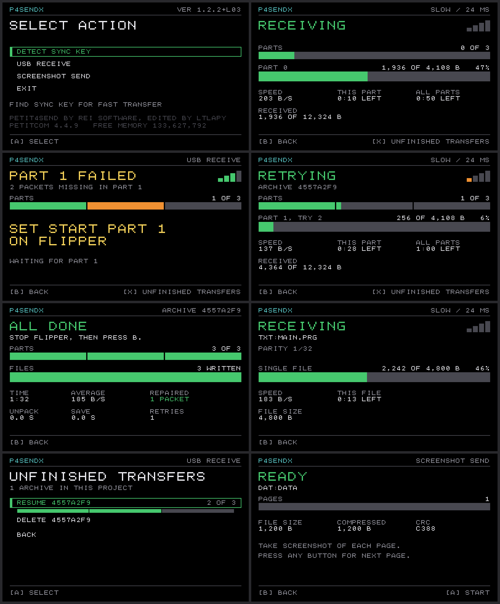

# p4sendx-tools

Keyboard-based file transfer, for SmileBASIC 4, using Flipper Zero

Forked from [Petit4Send](http://rei.to/petit4send.html) by Rei Software

## Features

- Sends from Flipper Zero alone. No PC while sending
- Works on unmodified Switch: Flipper acts as USB keyboard and mouse
- Sends whole project as one archive, compressed and CRC-checked
- Up to 656 bytes/s, no sync key
- Parity repairs lost packets. If a part still fails, resend only that part
- Resumes stopped transfer
- Progress bars and Link quality indicator
- P4SEND compability mode

## Speed

| Link | Bytes/s | 140 KB project | Needs |
|---|---:|---:|---|
| `Classic`, Slow | 206 | 13 min 23 s | Stock P4SEND or P4SENDX |
| `Classic`, Fast | 296 | 9 min 45 s | Stock P4SEND or P4SENDX, sync key |
| `NS1` | 562 | 5 min 54 s | P4SENDX. Use on Switch 1 |
| `NS2` | 656 | 5 min 15 s | P4SENDX. Use on Switch 2 |

## Start

Requirements:
- Flipper Zero on Momentum firmware
- Python 3 with Pillow on a PC.

1. [Set up](docs/guide.md#set-up) the Flipper app and P4SENDX.
2. Pack a project: `python3 pc/p4pack.py -o my.p4a MY_PROJECT_FOLDER`. Copy `my.p4a` to the SD card.
3. On SmileBASIC 4, run P4SENDX and choose `USB RECEIVE`.
4. On the Flipper, open `SB4 Send`, pick `my.p4a`, set `Config` > `P4S Link`, and press `Run`.
5. At `ALL DONE`, press `Stop` on the Flipper and B on the controller.

Check [Guide](docs/guide.md) for more information.

## Contents

| Folder | Contents | Licence |
|---|---|---|
| [`flipper/sb4_send`](flipper/sb4_send) | Flipper app | GPLv3 |
| [`p4sendx`](p4sendx) | SmileBASIC 4 program | MIT, with Rei Software's [notice](p4sendx/NOTICE) |
| [`pc`](pc) | `p4pack.py`, `p4recv.py` | MIT, with the [p4s notice](pc/LICENSE-p4s) |
| [`docs`](docs) | [Guide](docs/guide.md), [protocol](docs/protocol.md) | MIT |
| [`tests`](tests) | Tests of the Flipper core and PC tools | MIT |

Run the tests with `sh tests/run.sh`. They need a C compiler, Python 3 and Pillow, and no hardware.
To build the app, see [its README](flipper/sb4_send/README.md#build).

## Status

Tested on author's own Switch 1 and Switch 2. Keep copies of what you send.
Check [Hardware results](docs/guide.md#hardware-results) for test report.

This is an unofficial project, not affiliated with SmileBoom, Nintendo, Rei Software, Flipper Devices
or the Momentum team. Names and trademarks belong to their owners.
